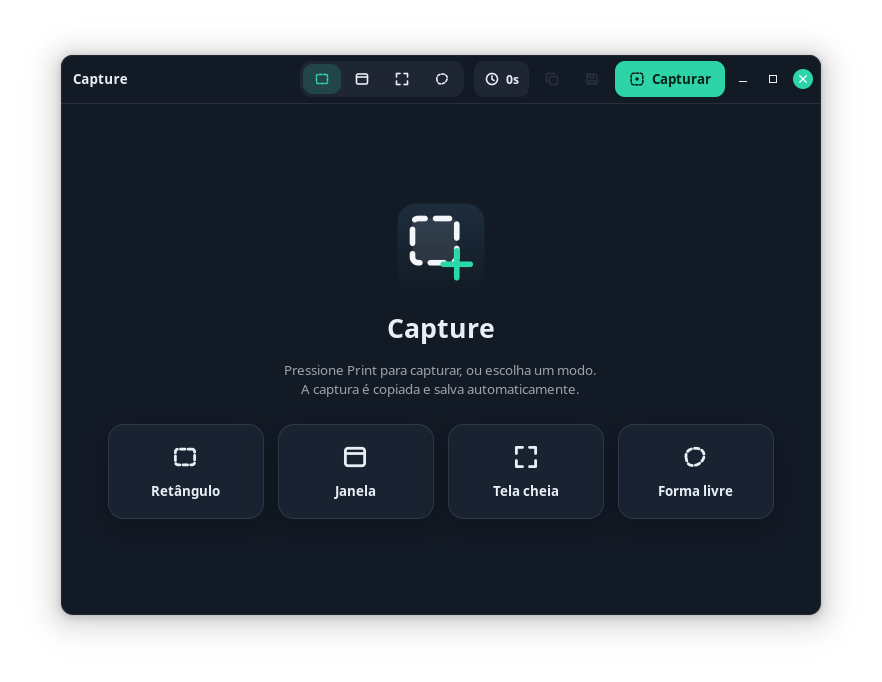
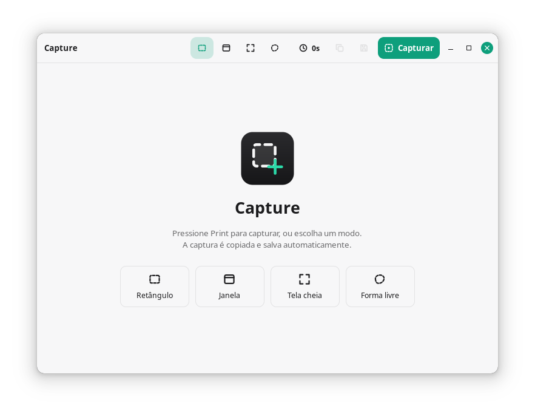
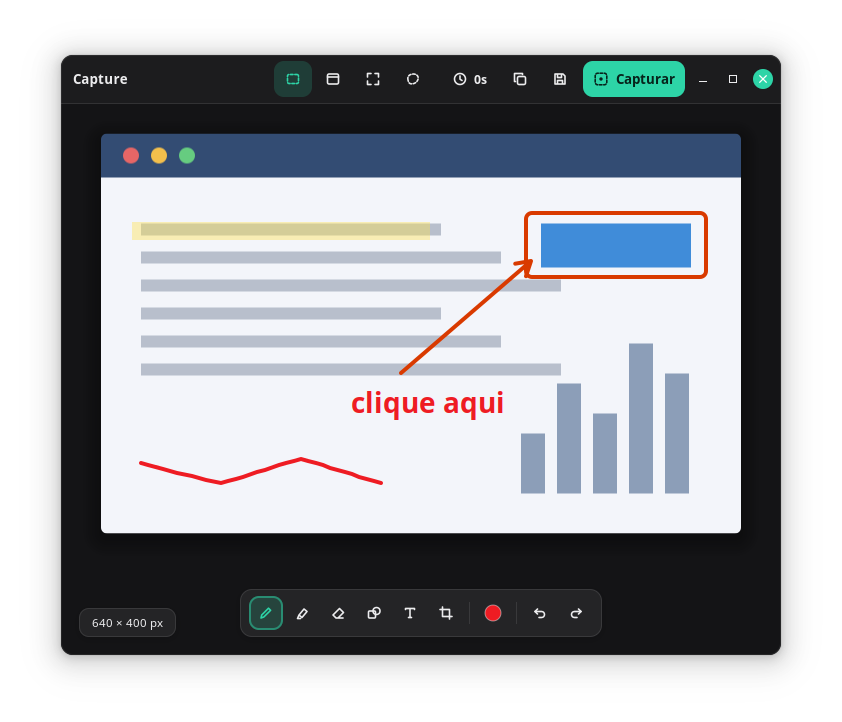
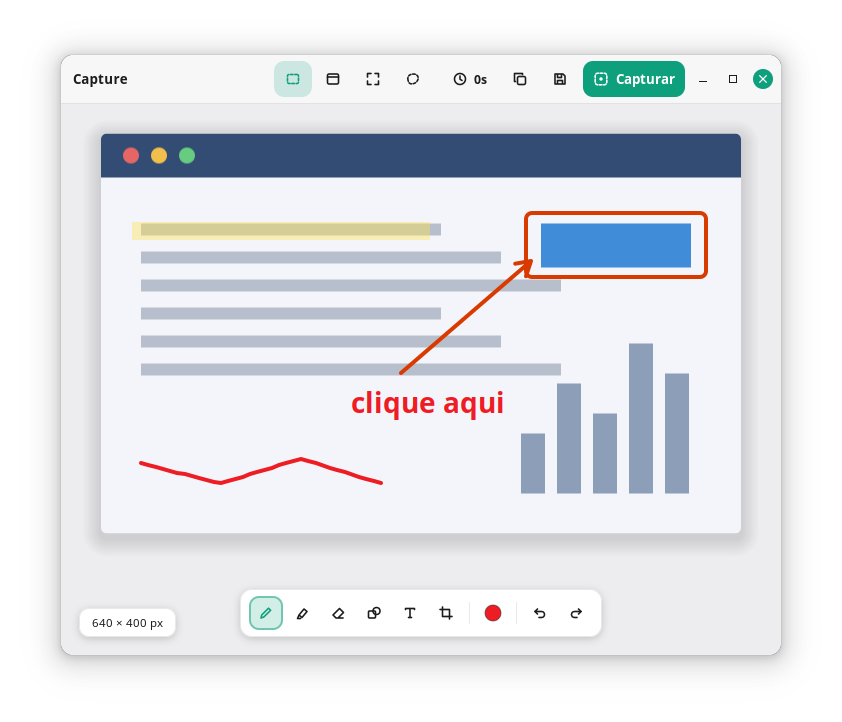

# Capture

Captura de tela e anotação para Linux, feita em Python com GTK 4 e libadwaita.
Você aperta Print, seleciona o que quer, e a imagem já fica copiada e salva. Se
quiser, marca por cima antes de colar em outro lugar.

| Dark | Clean |
|---|---|
|  |  |
|  |  |

## Recursos

- Quatro modos de captura: retângulo, janela, tela cheia e forma livre, escolhidos
  no seletor do cabeçalho ou nos cartões da tela inicial.
- Atraso opcional de 3, 5 ou 10 segundos (botão do relógio, ao lado do seletor).
- Funciona com mais de um monitor: a seleção aparece em todos.
- Editor com caneta, marca-texto, borracha, formas (retângulo, elipse, linha e
  seta), texto e corte, numa barra de ferramentas flutuante sobre a imagem.
- Desfazer e refazer.
- Toda captura nova é copiada para a área de transferência e salva em PNG
  automaticamente, antes de você anotar. Depois de anotar, copie ou salve de novo.
- Visual minimalista: cinzas grafite neutros, um único acento verde-água (só no botão
  Capturar e na ferramenta ou modo ativo) e painéis sólidos com borda fina.
  Tema escuro (Dark) e claro (Clean), seguindo o tema do Cinnamon (fora do
  Cinnamon, segue o padrão do sistema). Para fixar um deles, inicie com
  `CAPTURE_TEMA=escuro` ou `CAPTURE_TEMA=claro`.
- Avisos como "Copiado para a área de transferência" e "Salvo em ..." aparecem
  como mensagens passageiras; o tamanho da imagem fica num selo no canto.

Limites conhecidos:

- Uma seleção não atravessa dois monitores: arraste dentro de um deles.
- "Tela cheia" captura todos os monitores juntos, numa imagem só.
- A borracha apaga a marcação que você clicar (o traço da forma, não o miolo
  dela); um arraste da borracha conta como um único passo de desfazer.

## Instalação fácil (Flatpak)

O jeito recomendado: um único arquivo, com tudo dentro. Não precisa instalar
`maim`, `xclip`, Python nem GTK à parte.

1. Baixe `Capture.flatpak` na página de
   [Releases](https://github.com/kassiobraga/capture/releases).
2. Dê dois cliques no arquivo (abre o Gerenciador de Aplicativos) ou, no terminal:

   ```sh
   flatpak install --user Capture.flatpak
   ```

O Linux Mint, o Fedora e o Pop!_OS já vêm com Flatpak. No Ubuntu, instale uma vez
com `sudo apt install flatpak`.

Para a tecla Print abrir o Capture, crie um atalho de teclado personalizado com o
comando `flatpak run io.github.kassiobraga.Capture --novo` (no Cinnamon:
Configurações do sistema → Teclado → Atalhos → Atalhos personalizados).

As capturas vão para `~/Imagens/Capturas`, como na instalação manual. Para
publicar no Flathub (a loja, com atualização automática), veja
[docs/FLATHUB.md](docs/FLATHUB.md).

## Instalação manual (desenvolvimento)

### Requisitos

- **X11.** Wayland não é suportado por enquanto: a captura usa `maim` e a
  seleção depende de janelas X11.
- Python 3.10 ou mais novo (testado apenas com 3.12), **GTK 4.12 ou mais novo** e
  **libadwaita 1.4 ou mais nova**. O instalador confere as versões.
- `python3-xlib`, ou então `maim` e `xclip` e, para o modo "janela", `xprop` e
  `xwininfo` (pacote `x11-utils`). `rsvg-convert` é opcional e só gera os ícones PNG na instalação.

No Debian, Ubuntu e Linux Mint:

```sh
sudo apt install python3-gi python3-gi-cairo python3-cairo \
    gir1.2-gtk-4.0 gir1.2-adw-1 python3-xlib xclip librsvg2-bin
```

Desenvolvido e testado no Linux Mint 22 com Cinnamon 6.

### Instalação

A instalação é só para o seu usuário, em `~/.local`, sem sudo:

```sh
git clone <url-do-repositorio> capture
cd capture
./install.sh
```

O script confere as dependências e mostra o comando `apt` se algo faltar. Ele
instala:

| O quê | Onde |
| --- | --- |
| programa | `~/.local/share/io.github.kassiobraga.Capture/` |
| comando | `~/.local/bin/capture` |
| item de menu | `~/.local/share/applications/io.github.kassiobraga.Capture.desktop` |
| ícones | `~/.local/share/icons/hicolor/.../io.github.kassiobraga.Capture.(svg\|png)` |

Pode ser executado de novo para atualizar. Se já existir um `~/.local/bin/capture`
que não seja do Capture, o instalador recusa e não altera nada. Caminhos com
espaços ou caracteres especiais não são aceitos, nem no `HOME` nem na pasta onde
você clonou o repositório.

Para ligar a tecla Print ao Capture no Cinnamon:

```sh
./install.sh --bind-print
```

Isso cria (ou atualiza) um atalho personalizado chamado
"Capture (io.github.kassiobraga.Capture)" para `capture --novo` e faz o Cinnamon
recarregá-lo. Atalhos que você já tinha não são alterados; se outro atalho usar
Print, o script avisa. Em outros ambientes, associe a tecla ao comando
`capture --novo` pelas configurações do seu ambiente.

Certifique-se de que `~/.local/bin` está no `PATH`.

### Desinstalação

```sh
./uninstall.sh
```

Remove o programa, o comando, o item de menu, os ícones e o atalho do Capture,
e nada além disso. As imagens salvas não são apagadas.

## Uso

Aperte **Print** (se você ligou a tecla) ou abra "Capture" no menu. Arraste para
selecionar a área. Na barra flutuante, embaixo na tela, dá para trocar o modo;
**Esc** cancela. Um aviso no alto lembra o que fazer em cada modo. Ao soltar o
mouse, a captura abre no editor.

Linha de comando:

| Comando | O que faz |
| --- | --- |
| `capture` | abre a janela principal |
| `capture --novo` | inicia uma captura agora, sem atraso |
| `capture --novo --modo ret\|janela\|tela\|livre` | idem, no modo indicado |
| `capture --modo MODO` | também inicia uma captura agora, no modo indicado, usando o atraso escolhido na janela principal |
| `capture --abrir ARQUIVO.png` | abre um PNG no editor (caminho relativo vale a partir de onde você chamou) |

Se o Capture já estiver aberto, os comandos são enviados à instância em execução.
Se a captura falhar (por exemplo, sem o `maim`) ou o arquivo não abrir, uma
mensagem aparece na janela.

### Atalhos de teclado

No editor:

| Atalho | Ação |
| --- | --- |
| Ctrl+N | nova captura |
| Ctrl+C | copiar a imagem |
| Ctrl+S | salvar como... |
| Ctrl+Z | desfazer |
| Ctrl+Y ou Ctrl+Shift+Z | refazer |
| P / H / E | caneta / marca-texto / borracha |
| R / O / L / A | retângulo / elipse / linha / seta |
| T / X | texto / cortar |

Na seleção de área: **Esc** cancela.

### Onde as capturas são salvas

Em `Capturas`, dentro da pasta de imagens do usuário (normalmente
`~/Imagens/Capturas`, ou `~/Pictures/Capturas` em sistema em inglês), com nomes
como `Captura de tela 2026-11-12 153000.png`. Duas capturas no mesmo segundo
ganham ` (2)`, ` (3)`... no nome; nada é sobrescrito. A cópia para a área de
transferência usa `xclip` e não deixa arquivo em disco.

## Testes

Os testes unitários usam só a biblioteca padrão e não precisam de display:

```sh
python3 -m unittest discover -s tests
```

Os testes de ponta a ponta controlam o aplicativo **instalado** com mouse e
teclado simulados (XTest, via `python-xlib`) no seu desktop X11, e conferem
arquivos, área de transferência e a lista de janelas. Eles usam um id de
aplicativo e uma pasta de saída próprios, então não mexem nas suas capturas nem
numa instância que você tenha aberto. São pulados sozinhos sem display, sem XTest
ou sem o Capture instalado, e só rodam com `CAPTURE_E2E=1`. Rode com o desktop
livre (não mexa no mouse) por cerca de um minuto; a área de transferência é
restaurada ao fim de cada teste:

```sh
CAPTURE_E2E=1 python3 -m unittest discover -s tests/e2e -t .
```

O teste da tecla Print só roda se ela estiver vinculada a esta instalação
(`./install.sh --bind-print`). As variáveis `CAPTURE_APP_ID`, `CAPTURE_DIR` e
`CAPTURE_TEST_*` existem para esses testes (ver `capture/teste.py`).

As imagens desta página foram geradas por `docs/gerar_captura.py`.

## Estrutura

```
capture/      pacote Python (app, overlay, editor, icons, x11, arquivos)
data/         ícone SVG, modelo do .desktop e metainfo (AppStream)
flatpak/      manifesto do pacote Flatpak
docs/         imagens do README e o script que as gera
scripts/      funções do atalho do Cinnamon usadas pelos scripts de instalação
tests/        testes unitários; tests/e2e tem os de ponta a ponta
install.sh    instalação local
uninstall.sh  remoção
```

## Roadmap

- **1.0** (atual): captura (região, janela, tela inteira, área livre) e anotação,
  em pacote Flatpak com tudo incluso.
- **1.1**: salvar em PNG, JPEG ou PDF; edição simples (redimensionar em pixels ou
  %, borrar/pixelar, girar); capturas em abas, com "juntar abas em PDF".
- **1.2**: histórico das capturas num painel lateral, limpeza diária da lista e
  modo anônimo (não registra no histórico).
- **1.3**: gravação de tela (região, janela ou tela inteira) em MP4 ou GIF.
- **1.4**: captura rolável, para páginas e janelas mais compridas que a tela.
- **Depois**: suporte a Wayland (captura pelo portal do sistema).

## Licença

MIT. Veja o arquivo [LICENSE](LICENSE).
